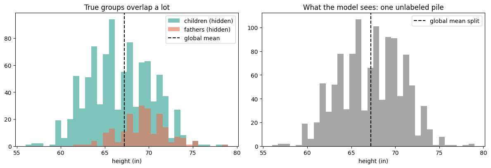
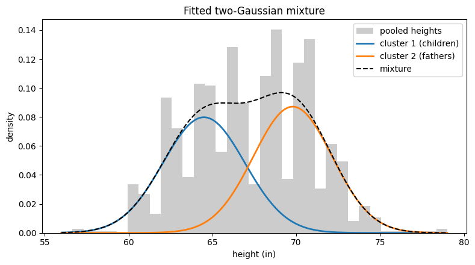
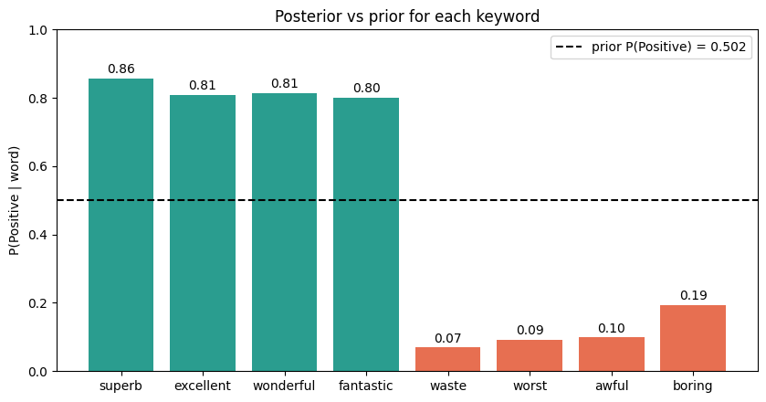

# Probability Distributions, Bayesian Probability, and Gradient Descent

**Formative 3 | Mathematics for Machine Learning | BSE, African Leadership University | Group 24**

## Group 24 Members

- Philip Mganga
- Methode Duhujubumwe
- Nathanaella Hirwa

---

## Project links

| What | Link |
|---|---|
| Notebook (Google Colab) | [Open the notebook in Colab](https://colab.research.google.com/drive/1-e_MzHVl_e3LmuHOe1zGwFofLqYXSV6Z?usp=sharing) |
| Team task sheet (live) | [Open the task sheet](https://docs.google.com/spreadsheets/d/12UGM8M3DCWtZxfs28Zg4xkIGg_Qt2Brxz2Dv-NWcc40/edit?usp=sharing) |
| Notebook (in this repo) | [notebooks/Group24_Formative3_Notebook.ipynb](notebooks/Group24_Formative3_Notebook.ipynb) |
| EM code (in this repo) | [src/em.py](src/em.py) |
| Task sheet (PDF copy) | [docs/Task_Sheet_Formative3_Team24.pdf](docs/Task_Sheet_Formative3_Team24.pdf) |
| Handwritten Part 3 | [Manual_Gradient_Descent.pdf](Manual_Gradient_Descent.pdf) |

---

## 1. What this project does

We worked on four connected problems. Each one uses a different way to reason with data.

| Part | Topic | Main idea |
|---|---|---|
| 1 | Expectation-Maximization (EM) | Split one unlabeled pile of heights into two hidden groups |
| 2 | Bayesian probability | Turn a keyword into the chance that a movie review is positive |
| 3 | Manual gradient descent | Do three updates by hand, using matrices |
| 4 | Gradient descent in code | Repeat the same updates in Python with SciPy and plot them |

Parts 1, 3 and 4 use NumPy, SciPy and Matplotlib. Part 2 uses only basic Python (`csv`, `re`, `collections`), as the assignment requires.

## 2. Repository map

```
group_24_probability/
├── README.md
├── requirements.txt
├── data/
│   ├── galton_families.csv      heights of parents and children
│   └── imdb_dataset.csv         50,000 labeled movie reviews
├── src/
│   └── em.py                    EM functions (Part 1)
├── notebooks/
│   └── Group24_Formative3_Notebook.ipynb   all four parts
├── images/                      plots used in the notebook
├── docs/
│   └── Task_Sheet_Formative3_Team24.pdf
└── Manual_Gradient_Descent.pdf  handwritten Part 3, one combined file
```

## 3. How to run it

1. Clone the repository: `git clone https://github.com/pmganga/group_24_probability.git`
2. Install the libraries: `pip install -r requirements.txt`
3. Open `notebooks/Group24_Formative3_Notebook.ipynb` in Jupyter or Colab and use Run All.

The notebook finds the data in the `data` folder. If it is missing (for example in a new Colab session), it downloads the two CSV files from this repo by itself.

---

## 4. Part 1: Expectation-Maximization (Philip)

### Data

We use the Galton families file and compare **fathers** with **children**. We keep one father per family (205 values) and all children (934 values), then pool them into one list of 1,139 heights and remove the labels. The model never sees who is a father and who is a child. The labels are kept only to check the result afterwards.



The two groups overlap a lot, so the pooled data forms one bumpy hill.

### How the algorithm works

- **Start (iteration 0):** the two means start at the 25th and 75th percentile of the data (64.5 and 70.0). Both variances start equal to the variance of all the data, and both weights start at 0.5.
- **E-step:** for every height, work out how responsible each group is for it. This uses the Gaussian density times the group's weight, divided so the two shares add up to 1. This is a soft assignment.
- **M-step:** update each group's mean, variance and weight, using those shares as weights.
- **Stop:** repeat until the log-likelihood changes by less than 0.000001. Our run stopped after **319 iterations**, with a log-likelihood of about -3046.99.

### Tracking table (from our code in `src/em.py`)

| Iteration | mu1 (Children) | mu2 (Fathers) | sigma1^2 | sigma2^2 | pi1 | pi2 | Log-likelihood |
|---|---|---|---|---|---|---|---|
| 0 (start) | 64.5000 | 70.0000 | 12.7241 | 12.7241 | 0.5000 | 0.5000 | -3119.8222 |
| 1 | 65.2205 | 69.2054 | 9.0603 | 8.4468 | 0.5011 | 0.4989 | -3057.9135 |
| 2 | 65.1609 | 69.2600 | 8.9420 | 8.1040 | 0.5005 | 0.4995 | -3056.9719 |

After 319 iterations EM settles at means of **64.18** (children) and **69.52** (fathers), variances of 5.30 and 6.04, and weights of 0.432 and 0.568. The real group means are 66.75 and 69.32.



### Classifying a height

For any height, the model gives the exact probability of each group. Examples from our code:

| Height (in) | P(Child) | P(Father) |
|---|---|---|
| 60 | 0.9965 | 0.0035 |
| 64 | 0.9098 | 0.0902 |
| 66 | 0.6236 | 0.3764 |
| 67.21 (global mean) | 0.3469 | 0.6531 |
| 69.5 | 0.0532 | 0.9468 |
| 72 | 0.0042 | 0.9958 |

In the presentation, the coach gives us a height and we run `classify(height, params)` live.

### Should we split at the global mean?

No. The global mean of all heights is 67.21 inches. A line there makes 575 heights one pile and 564 the other.

- **It makes many wrong calls.** The line puts 403 children above the mean and 44 fathers below it, so each pile's average comes from the wrong people.
- **It gives no sign of doubt.** A person of 66.75 inches gets a fixed label, but EM says 45% child and 55% father. In the zone between 65.2 and 67.8 inches (230 heights), EM gives between 20% and 80% to each group.
- **It assumes the groups have the same size and spread.** Ours do not: there are about 4.6 times more children than fathers, and the spreads differ.
- **It does not improve itself.** EM keeps improving the fit until the log-likelihood stops changing.

One honest note: when we count correct labels, the mean split scores 60.8% and EM's hard assignment 56.5%. EM is not trying to maximize that score. It fits two bell curves to the data and gives soft probabilities, and the two groups here overlap so much that any method will make many mistakes.

---

## 5. Part 2: Bayesian probability on IMDb reviews (Methode)

**Question.** If a review contains a certain word, how likely is it to be positive?

**Bayes' Theorem:** P(Positive | word) = P(word | Positive) x P(Positive) / P(word)

We compute **P(Positive | word) only**. We do not compute P(Negative | word).

### 5.1 Data cleaning

1. **Duplicates.** The file has 418 repeated reviews. We keep one copy of each text, which leaves **49,582** distinct reviews (24,884 positive and 24,698 negative). No text had two different labels.
2. **HTML tags.** 29,210 reviews contain tags such as `<br />`. We remove every tag, because left in they create a fake word `br`.
3. **Normal text.** We lower-case everything and keep only letters and apostrophes.
4. **Whole words only.** Each review becomes a set of words, so "bad" does not match "badge" and a word is counted once per review.

### 5.2 How we chose the keywords

We tested 19 candidate words on the data. We looked for a strong signal (the posterior far from the prior) and a large count (so the estimate is stable). We rejected "great" and "bad": they appear in many reviews of both types ("not bad", "not great").

| Type | Keyword | Reason |
|---|---|---|
| Positive | superb | Very strong signal, rarely used as a joke |
| Positive | excellent | Common and clearly positive |
| Positive | wonderful | Common and clearly positive |
| Positive | fantastic | Strong signal, different wording |
| Negative | waste | "Waste of time" is almost always negative |
| Negative | worst | Superlative of a negative idea |
| Negative | awful | Strong negative word |
| Negative | boring | A very common complaint |

### 5.3 The four probabilities

- **Prior** P(Positive) = positive reviews / all reviews = 24,884 / 49,582 = 0.5019
- **Likelihood** P(word | Positive) = positive reviews with the word / positive reviews
- **Marginal** P(word) = P(word | Positive) x P(Positive) + P(word | Negative) x P(Negative), the law of total probability. We also counted it directly, and both ways agree for every keyword.
- **Posterior** P(Positive | word) = likelihood x prior / marginal

**Zero counts.** If a word never appears, the marginal is 0 and the division would fail. The code falls back to the prior, and a smoothed version (add 1 to each count) is available.

### 5.4 Results

| Keyword | Type | Prior | Likelihood | Marginal | Posterior |
|---|---|---|---|---|---|
| superb | Positive | 0.5019 | 0.0412 | 0.0241 | 0.8569 |
| excellent | Positive | 0.5019 | 0.1146 | 0.0712 | 0.8082 |
| wonderful | Positive | 0.5019 | 0.0903 | 0.0557 | 0.8138 |
| fantastic | Positive | 0.5019 | 0.0433 | 0.0271 | 0.8013 |
| waste | Negative | 0.5019 | 0.0070 | 0.0504 | 0.0692 |
| worst | Negative | 0.5019 | 0.0163 | 0.0884 | 0.0927 |
| awful | Negative | 0.5019 | 0.0113 | 0.0575 | 0.0986 |
| boring | Negative | 0.5019 | 0.0236 | 0.0611 | 0.1941 |



### 5.5 What the numbers tell us

- Each positive word lifts the chance of a positive review from about 50% to about 80 to 86%. Each negative word drops it to about 7 to 19%.
- The negative words are stronger evidence than the positive ones. People tend to use harsher and more specific words when they complain.
- No word reaches 0% or 100%. Reviews contain negations ("not boring") and quotes, so one word is evidence and not proof.
- Limit: we look at one word at a time and ignore word order. This is Bayes' Theorem on a keyword, not a full classifier.

---

## 6. Part 3: Manual gradient descent (all three members)

The model is y = X m + b, with X = [[1, 3], [4, 10]], y = [5, 6], and start m = [-1, 2], b = 1. Everything is done with matrices. The cost is J = (1/n) x sum of (prediction - y)^2 with n = 2, and we use the chain rule for each derivative:

- dJ/dm = (2/n) X^T (y_hat - y)
- dJ/db = (2/n) sum of (y_hat - y)

Learning rate: **0.01**. We also tried 0.1, but the error exploded, so it is too large for this data.

The three iterations run as a relay, and each person starts from the previous person's result.

| Iteration | Done by | Starts from | Ends at | Cost J before / after |
|---|---|---|---|---|
| 1 | Philip | m = [-1, 2], b = 1 | m = [-1.45, 0.87], b = 0.88 | 61.0000 to 6.8450 |
| 2 | Methode | m = [-1.45, 0.87], b = 0.88 | m = [-1.3316, 1.1808], b = 0.9318 | 6.8450 to 2.7238 |
| 3 | Nathanaella | m = [-1.3316, 1.1808], b = 0.9318 | m = [-1.3696, 1.0952], b = 0.9362 | 2.7238 to 2.3904 |

**Trend.** The cost falls at every step (61.0, 6.845, 2.724, 2.390), so m and b are moving in the direction that reduces the error. The steps also get smaller as the cost falls, which is what we expect when the gradient shrinks.

The full handwritten pages are in `Manual_Gradient_Descent.pdf`.

---

## 7. Part 4: Gradient descent in code (Nathanaella)

<!-- Nathanaella: write this section from your own notebook results. Cover: the predict, MSE, gradient and update functions, the SciPy derivative function, the loop that prints every step, the final m and b with predictions, and the two plots (m and b over iterations, error over iterations). Use the real numbers from your run. -->

---

## 8. Code design

Each step is a small function defined once and reused:

- **Part 1 (`src/em.py`):** `load_heights`, `gaussian_pdf`, `initialise`, `e_step`, `m_step`, `log_likelihood`, `fit_em`, `tracking_table`, `classify`.
- **Part 2 (notebook):** `load_reviews`, `drop_duplicates`, `clean_review`, `tokenize`, `count_word`, `bayes_for_word`.
- **Part 4 (notebook):** see section 7.

## 9. Who did what

| Member | Main part | Also |
|---|---|---|
| Philip Mganga | Part 1 (EM algorithm, live classification) | Repo setup, manual iteration 1 |
| Methode Duhujubumwe | Part 2 (Bayes, data cleaning) | Height plots, manual iteration 2, notebook assembly |
| Nathanaella Hirwa | Part 4 (gradient descent code, plots) | Manual iteration 3, contributions PDF |

A detailed breakdown is in the contributions PDF submitted with this repository. Git logs show each person's commits. Every member should be able to explain every part.